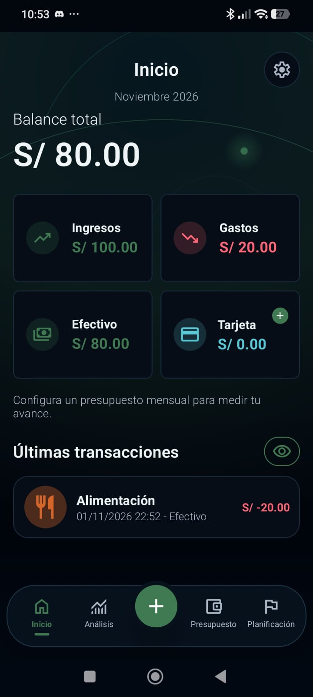
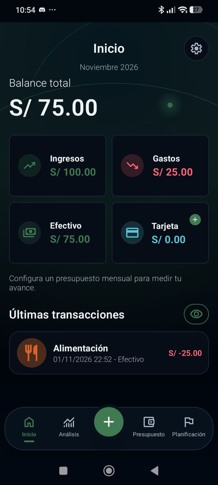

# Prueba manual de registro y edición de gastos

| Dato | Resultado observado |
| --- | --- |
| Responsable | Jhostyn Rafael Morales Figueroa (`jrafael18`) |
| Fecha de la prueba | 01/11/2026 |
| Modelo del celular | Redmi Note 14 |
| Saldo inicial | S/ 100.00 en efectivo |
| Saldo después del gasto de S/ 20 | S/ 80.00 |
| Saldo después de editarlo a S/ 25 | S/ 75.00 |
| Gastos con la nota «Prueba Jhostyn» | 1, según el registro del participante |

## Pasos realizados

1. Ingresé a la aplicación en modo invitado.
2. Configuré el saldo inicial de S/ 100.00 en efectivo y S/ 0.00 en tarjeta.
3. Comprobé que Inicio mostrara un balance de S/ 100.00.
4. Registré un gasto de S/ 20.00 en la categoría Alimentación, con pago en efectivo y la nota «Prueba Jhostyn».
5. Regresé a Inicio y comprobé que el balance fuera S/ 80.00.
6. Abrí el mismo gasto, cambié su monto a S/ 25.00 y guardé la modificación.
7. Comprobé que el balance fuera S/ 75.00 y que apareciera un único gasto de S/ 25.00.
8. Tomé capturas del saldo inicial y de los resultados del registro y la edición.

## Resultado y observaciones

La prueba fue satisfactoria en el flujo evaluado. El registro del gasto de S/ 20.00 redujo el saldo de S/ 100.00 a S/ 80.00. Al editar el mismo movimiento a S/ 25.00, el saldo se actualizó a S/ 75.00 y el total de gastos a S/ 25.00. En Inicio se mantuvo un único movimiento visible, sin duplicarse tras la edición.

## Evidencias

Las capturas acreditan los saldos y el movimiento visible. La nota está declarada en el registro del participante y no se muestra en Inicio.

| Saldo inicial | Registro del gasto | Edición del gasto |
| --- | --- | --- |
|  |  |  |

Registro original: [12d1156](https://github.com/mysticc101/app-finanzas/commit/12d11563b8d9004cb34587d688164aff8d5703a3). Ajuste del participante: [c74d0b3](https://github.com/mysticc101/app-finanzas/commit/c74d0b3a6e2996a69ac543f10c4002da43d6123d).
