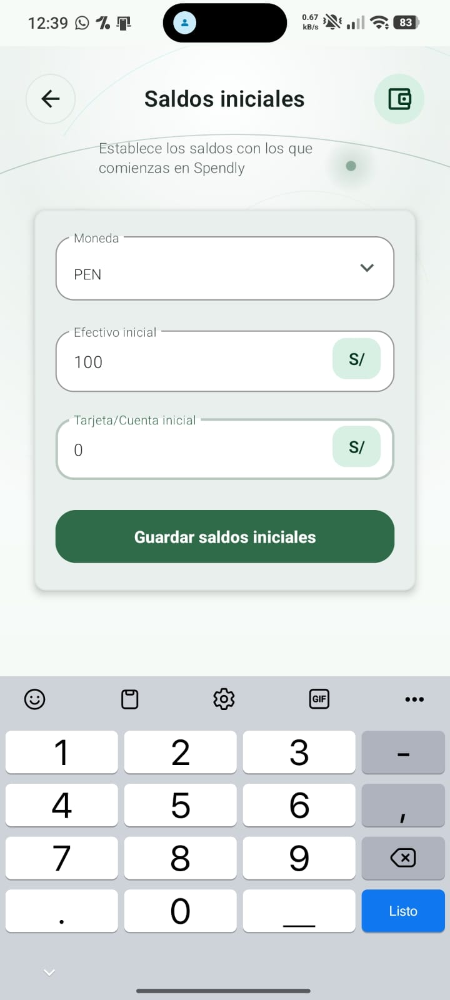
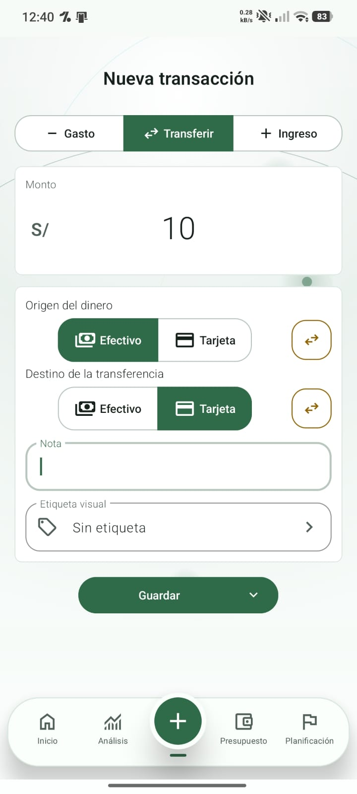
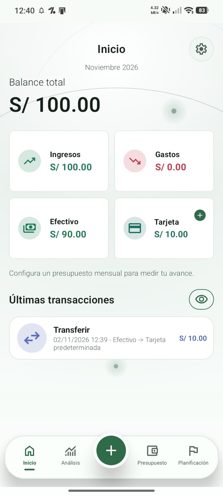

# Prueba manual de transferencia entre cuentas

| Dato | Registro |
| --- | --- |
| Responsable | Dennis Fabián Decurt Bendezú (`dfdecurt11-droid`) |
| Fecha de la prueba | 02/11/2026 |
| Modelo declarado por el participante | Redmi Note 13 Pro Max |
| Efectivo antes y después | S/ 100.00 → S/ 90.00 |
| Tarjeta/Cuenta antes y después | S/ 0.00 → S/ 10.00 |
| Saldo total antes y después | S/ 100.00 → S/ 100.00 |
| Conservación de saldos al volver a Inicio | Sí, según la comprobación del participante |

## Pasos realizados

1. Configuración de saldo inicial en PEN: 100 en efectivo y 0 en tarjeta.
2. Transferencia de S/ 10 de efectivo a tarjeta/cuenta.
3. Validación en la pantalla principal y navegación entre pantallas.

## Resultado y observaciones

La transferencia se procesó correctamente: los saldos cuadran y se mantuvieron estables al navegar entre pantallas, según el registro de Dennis. Inicio muestra efectivo S/ 90.00, tarjeta S/ 10.00, balance total S/ 100.00 y gastos S/ 0.00. Esta verificación no incluye una prueba de recuperación tras reinstalar la aplicación.

## Evidencias

| Preparación de saldos | Transferencia de S/ 10 | Resultado en Inicio |
| --- | --- | --- |
|  |  |  |

Registro original: [9f624c6](https://github.com/mysticc101/app-finanzas/commit/9f624c698bfaecd7f900b4a67b39ffde77ff8648).
